<!-- Generated assets live in assets/. To change them, edit studio/content.py and run `python -m studio build`. -->

<picture>
  <source media="(prefers-color-scheme: dark)" srcset="./assets/hero-dark.svg">
  <source media="(prefers-color-scheme: light)" srcset="./assets/hero-light.svg">
  
</picture>

&nbsp;

I'm a full-stack engineer who started in product design, so I care about both ends of a feature: how it feels in the hand and how it behaves under the hood. I build interfaces in **TypeScript and React**, services in **Python, Java, Node.js and Go**, and data models in **SQL**, and I ship the design work myself in **Figma and Framer**.

<picture>
  <source media="(prefers-color-scheme: dark)" srcset="./assets/architecture-dark.svg">
  <source media="(prefers-color-scheme: light)" srcset="./assets/architecture-light.svg">
  
</picture>

<picture>
  <source media="(prefers-color-scheme: dark)" srcset="./assets/code-dark.svg">
  <source media="(prefers-color-scheme: light)" srcset="./assets/code-light.svg">
  
</picture>

<picture>
  <source media="(prefers-color-scheme: dark)" srcset="./assets/stack-dark.svg">
  <source media="(prefers-color-scheme: light)" srcset="./assets/stack-light.svg">
  
</picture>

<picture>
  <source media="(prefers-color-scheme: dark)" srcset="./assets/work-heading-dark.svg">
  <source media="(prefers-color-scheme: light)" srcset="./assets/work-heading-light.svg">
  
</picture>

<a href="https://liftiq.in">
  <picture>
    <source media="(prefers-color-scheme: dark)" srcset="./assets/project-liftiq-dark.svg">
    <source media="(prefers-color-scheme: light)" srcset="./assets/project-liftiq-light.svg">
    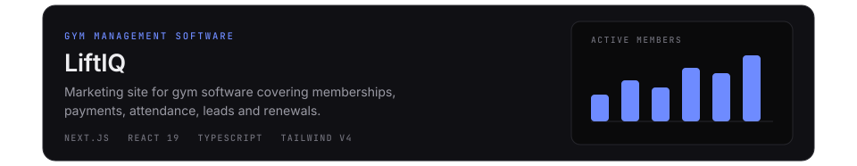
  </picture>
</a>
<a href="https://github.com/Yasar-404/envguard">
  <picture>
    <source media="(prefers-color-scheme: dark)" srcset="./assets/project-envguard-dark.svg">
    <source media="(prefers-color-scheme: light)" srcset="./assets/project-envguard-light.svg">
    
  </picture>
</a>
<a href="https://github.com/Yasar-404/url-shortener-go">
  <picture>
    <source media="(prefers-color-scheme: dark)" srcset="./assets/project-shortener-dark.svg">
    <source media="(prefers-color-scheme: light)" srcset="./assets/project-shortener-light.svg">
    
  </picture>
</a>
<a href="https://github.com/Yasar-404/v4-fitness-walk-in-system">
  <picture>
    <source media="(prefers-color-scheme: dark)" srcset="./assets/project-walkin-dark.svg">
    <source media="(prefers-color-scheme: light)" srcset="./assets/project-walkin-light.svg">
    
  </picture>
</a>

**Design and web work for clients:** [Cassinil Engineers](https://cassinil.in) · [V4 Fitness Hub](https://v4-fitness-hub.vercel.app) · [Rune Designs](https://runedesigns.framer.website) · [A Organic Beauty Salon](https://aorganicbeautysalon.framer.website) · [Case studies on Behance](https://www.behance.net/yasardesigns)

<picture>
  <source media="(prefers-color-scheme: dark)" srcset="./assets/activity-dark.svg">
  <source media="(prefers-color-scheme: light)" srcset="./assets/activity-light.svg">
  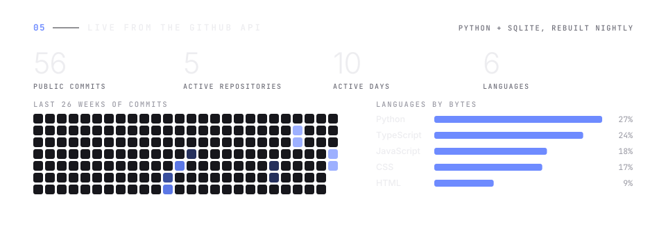
</picture>

<details>
<summary><b>How this profile is built</b></summary>

&nbsp;

This README is a small production system. A scheduled GitHub Action pulls public data, models it in SQL and renders every animated image with no third-party widgets.

```text
GitHub REST API ──> studio/github.py ──> data/snapshot.json
                                              │
                         SQLite (in memory) <─┘  studio/sql/*.sql
                                              │
                    Metrics ──> studio/sections/*.py ──> assets/*.svg
```

For example, the longest commit streak is a gaps-and-islands query ([`longest_streak.sql`](studio/sql/longest_streak.sql)):

```sql
WITH days AS (
    SELECT DISTINCT committed_on AS day FROM commits
),
islands AS (
    SELECT
        day,
        CAST(julianday(day) AS INTEGER) - ROW_NUMBER() OVER (ORDER BY day) AS island
    FROM days
)
SELECT COALESCE(MAX(length), 0) AS longest_streak
FROM (SELECT COUNT(*) AS length FROM islands GROUP BY island);
```

- **Outlined type:** GitHub's image sandbox can't load web fonts, so text is converted to deduplicated vector glyphs and looks the same on every OS.
- **Accessible motion:** all animation is CSS, so `prefers-reduced-motion` stops it and leaves a complete resting state. Dark and light themes each get their own render.
- **Tested:** `pytest` covers the SQL, the API client and every rendered asset, and CI runs it with `ruff` on each push. See [`docs/ENGINEERING.md`](docs/ENGINEERING.md).

</details>

<picture>
  <source media="(prefers-color-scheme: dark)" srcset="./assets/contact-dark.svg">
  <source media="(prefers-color-scheme: light)" srcset="./assets/contact-light.svg">
  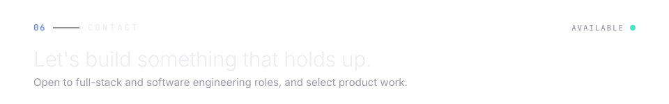
</picture>

<p>
  <a href="https://yasardesigns.framer.website"><picture><source media="(prefers-color-scheme: dark)" srcset="./assets/btn-portfolio-dark.svg"><source media="(prefers-color-scheme: light)" srcset="./assets/btn-portfolio-light.svg">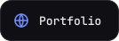</picture></a>
  <a href="https://www.linkedin.com/in/yasar-k-31540a1b9/"><picture><source media="(prefers-color-scheme: dark)" srcset="./assets/btn-linkedin-dark.svg"><source media="(prefers-color-scheme: light)" srcset="./assets/btn-linkedin-light.svg">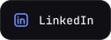</picture></a>
  <a href="mailto:iamnotyasar@gmail.com"><picture><source media="(prefers-color-scheme: dark)" srcset="./assets/btn-email-dark.svg"><source media="(prefers-color-scheme: light)" srcset="./assets/btn-email-light.svg">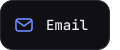</picture></a>
  <a href="https://github.com/Yasar-404?tab=repositories"><picture><source media="(prefers-color-scheme: dark)" srcset="./assets/btn-github-dark.svg"><source media="(prefers-color-scheme: light)" srcset="./assets/btn-github-light.svg">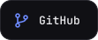</picture></a>
  <a href="https://www.behance.net/yasardesigns"><picture><source media="(prefers-color-scheme: dark)" srcset="./assets/btn-behance-dark.svg"><source media="(prefers-color-scheme: light)" srcset="./assets/btn-behance-light.svg">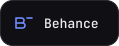</picture></a>
</p>

<picture>
  <source media="(prefers-color-scheme: dark)" srcset="./assets/footer-dark.svg">
  <source media="(prefers-color-scheme: light)" srcset="./assets/footer-light.svg">
  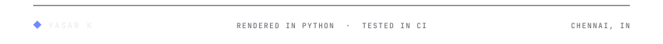
</picture>
